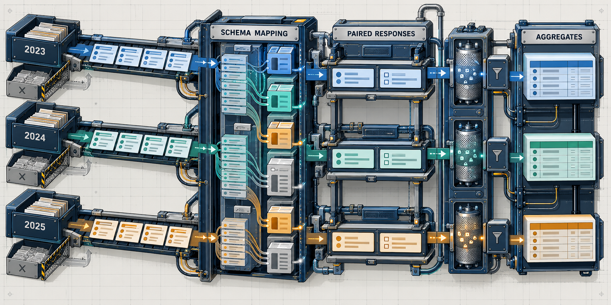
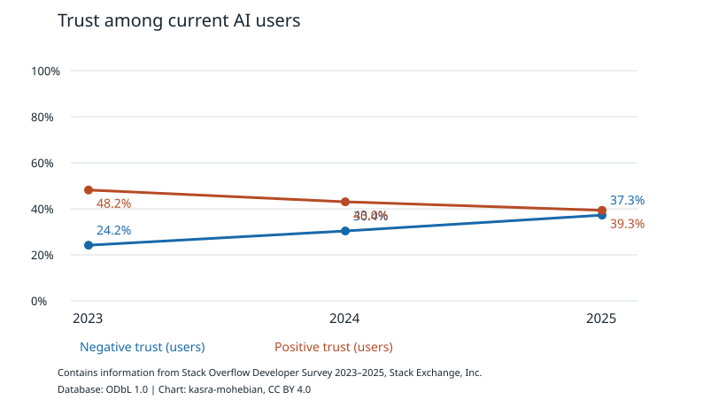

# AI Coding Tools: Adoption & Developer Trust (2023–2025)



*Technical concept illustration of independent annual survey inputs, schema mapping and aggregate outputs; not a result chart.*

[](https://github.com/kasra-mohebian/ai-developer-trust/actions/workflows/checks.yml)

**AI use is growing. Is trust keeping up?** A reproducible Python analysis of three Stack Overflow Developer Surveys, with source code, aggregate data and documented survey definitions.

The Python pipeline handles changes in the survey questions, keeps neutral answers separate from distrust and compares clearly defined respondent groups. The published tables can be reproduced from the official source files.



## Results at a glance

| Year | Positive trust among AI users | Users answering trust |
|---|---:|---:|
| 2023 | 48.2% | 38,888 |
| 2024 | 43.0% | 37,302 |
| 2025 | 39.3% | 26,126 |

Positive trust is lower in each successive annual sample **among current AI users who answered the trust question**. These are different, self-selected samples, not a panel following the same people. Survey wording and nonresponse also limit comparability.

The all-respondent trust percentage mixes users and non-users differently by year: the 2024 source contains no non-user trust answers, while 2023 and 2025 do. Those pooled percentages reflect both trust and who answered the question, so they are not directly comparable. The original [annual table](results/annual_summary.csv) and [chart](results/adoption-and-trust.svg) remain available as historical outputs. The [users-only table](results/users_only_trust.csv) is derived by code from the preserved [joint counts](results/adoption_trust_joint.csv).

## What this project implements

- [Core analysis](src/trust_analysis/core.py): exact category mapping, paired statistics and group summaries.
- [CLI pipeline](src/trust_analysis/__main__.py): source-schema checks, input hashes, aggregate outputs and static SVG generation.
- [Method](docs/method.md): question mapping, denominators, uncertainty and limitations.
- [Results and interpretation](docs/findings.md): what the tables support.
- [Tests](tests/): synthetic edge cases and end-to-end execution checks.
- [Source data instructions](data/README.md): obtain the official snapshots without committing respondent records.

A key implementation detail is that **2023 trust is stored in AIBen, while 2024/2025 trust is stored in AIAcc**. The code validates the question text against the supplied annual schema instead of assuming an unchanged field name means an unchanged concept. Neutral trust is kept separate from distrust; paired answers remain tied to the same respondent.

## Run it locally

The synthetic tests run without downloading the surveys. To reproduce the published analysis, download the three annual datasets separately.

Python 3.11+ is required; validation used Python 3.12. Install the pinned dependencies and arrange the original survey files as described in [data/README.md](data/README.md).

```bash
python -m venv .venv
source .venv/bin/activate
python -m pip install -r requirements.txt
PYTHONPATH=src python -m unittest discover -s tests -v

# After obtaining the official survey files:
PYTHONPATH=src python -m trust_analysis --data-root data/raw --output new-results
```

The output directory must be new. The checked-in `results/` are aggregate outputs from the documented snapshots. A later source revision may have a different hash or category set; inspect the difference before replacing results.

## Reading the results responsibly

The input files contain 203,812 annual response records; 182,600 have an adoption answer. These are not verified unique people or an exclusively professional-developer sample. The aggregate output tables include distributions, same-respondent adoption/trust cross-tabs, trust/sentiment correlation and role/experience/organization summaries. Start with [annual_summary.csv](results/annual_summary.csv), then inspect [statistics.json](results/statistics.json) and [source provenance](results/provenance.json).

The project developed from a course research study. This public edition reorganizes and rechecks the analysis; see [edition notes](docs/public-edition.md). It does not claim a peer-reviewed publication or supervisor endorsement of the revision.

## Contributing

Corrections to question mappings, statistical assumptions and reproducibility instructions are welcome. Include the relevant survey year, source question and a minimal synthetic example when reporting an analysis issue. Keep respondent records and personal details out of public issues; see [security and data handling](SECURITY.md).

## Attribution and licenses

Data source: **Stack Overflow Developer Survey, Stack Exchange, Inc., 2023, 2024 and 2025**. [Official survey archive](https://survey.stackoverflow.co/) · [Official source repository](https://github.com/StackExchange/Survey).

Code is under MIT; original explanatory text and charts are under CC BY 4.0; applicable database rights in the aggregate tables follow ODbL 1.0. Third-party source data and dependencies retain their own terms. See [LICENSES.md](LICENSES.md). No respondent-level data or original teaching/submission files are distributed.

## Publication status

This is a personal portfolio repository, not an official publication of the University of Bamberg.
